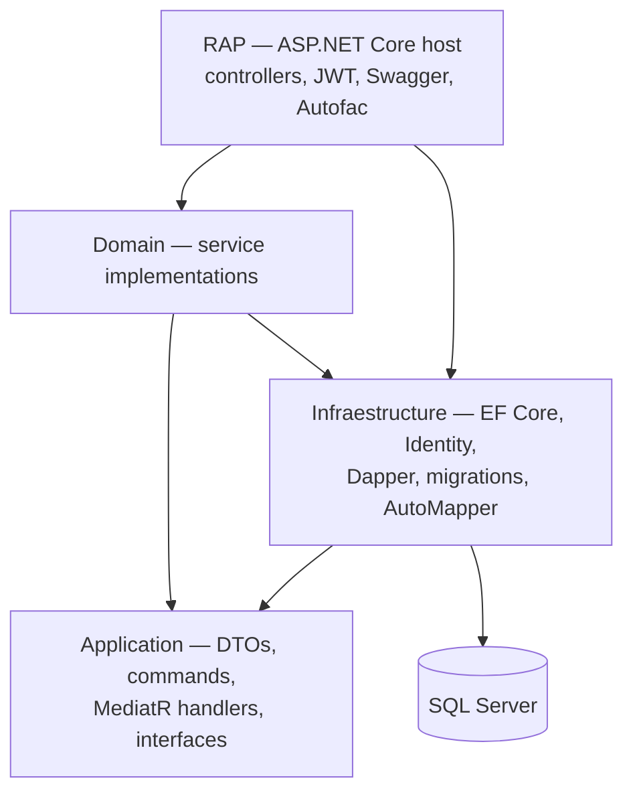

# RAP

Layered ASP.NET Core 6 Web API for user accounts, organizations, and battles (batalhas). The solution file is `RAP.sln`. The GitHub repository is named Ecommerce-Api; product and category types still exist in the unreferenced `ADTO` project, and that project is not part of the running API.

Most routes require a JWT. Swagger is available when the host runs in Development.

## Architecture

The host does not contain the domain model. Projects reference each other as follows:



| Project | Role |
| --- | --- |
| `RAP` | HTTP host. Controllers, JWT bearer authentication, Swagger, Autofac registration, and the EF Core SQL Server registration. |
| `Application` | Request and response types (under `Application/ADTO`), MediatR commands and handlers, and repository and service interfaces. |
| `Domain` | Service implementations (`Usuario`, `Organizacao`, `Batalha`, login cache). This project references both `Application` and `Infraestructure`. |
| `Infraestructure` | `ApplicationDbContext` (ASP.NET Identity + EF Core), SQL Server migrations, Dapper and EF repositories, and the AutoMapper profile. The folder name is spelled `Infraestructure`. |
| `ADTO` | Class library that is **not** included in `RAP.sln`. It holds older user, role, product, and category types and is not wired into the host. |

Autofac scans the host, Application, Domain, and Infrastructure assemblies and registers types as their implemented interfaces. MediatR is registered in `RAP/Program.cs` with `Assembly.GetExecutingAssembly()`, so the scan covers the host assembly. The command handlers live in `Application`.

## Tech stack

Verified from the project files:

- .NET 6 (`net6.0`) and ASP.NET Core
- Entity Framework Core 6 with the SQL Server provider
- ASP.NET Core Identity (`IdentityDbContext` for users and roles)
- JWT Bearer authentication (`Microsoft.AspNetCore.Authentication.JwtBearer`), HMAC-SHA512 signatures
- MediatR 10
- Autofac 6
- AutoMapper 12
- Dapper 2 (used by the repositories alongside EF Core)
- Swashbuckle.AspNetCore 6 (Swagger UI only when `ASPNETCORE_ENVIRONMENT` is `Development`)
- Newtonsoft.Json is referenced; the host uses the default ASP.NET Core JSON serializer
- Dockerfiles based on `mcr.microsoft.com/dotnet/sdk:6.0` and `aspnet:6.0` (see [Docker](#docker))

There is no test project in the solution.

## Features and endpoints

A global authorization filter requires an authenticated user. `POST /api/Auth/Login` and `POST /api/Auth/Register` are anonymous. Other routes expect `Authorization: Bearer <token>`.

The login flow signs a JWT and stores a row in `LoginCache`. Logout (`DeslogarUsuario`) deletes that cache row by the bearer token. It does not revoke the JWT itself.

| Method | Route | Auth | What the code does |
| --- | --- | --- | --- |
| `GET` | `/api/Auth?userName=` | JWT | Loads an Identity user by username. |
| `POST` | `/api/Auth/Login` | Anonymous | Checks the password. On success returns `{ token, user }`. Otherwise returns `200` with a message (`Usuário já está logado!` or `Usuário ou senha incorretos!`). |
| `POST` | `/api/Auth/Register` | Anonymous | Creates an Identity user. Returns `201` on success, `400` with Identity errors, or `200` with `{ userExists: true }`. |
| `POST` | `/api/Auth/DeslogarUsuario` | JWT | Removes the login-cache row for the bearer token. |
| `GET` | `/api/Usuario?userName=` | JWT | Searches users by name or nickname (`Apelido`). |
| `GET` | `/api/Organizacao` | JWT | Filters organizations by name, street, number, postal code, or CNPJ. |
| `GET` | `/api/Organizacao/ObterOrganizacaoUsuario` | JWT | Organizations for the user stored in the login cache. |
| `POST` | `/api/Organizacao` | JWT | Creates an organization (MediatR `AdicionarOrganizacaoCommand`). |
| `GET` | `/api/Batalha?DataBatalha=` | JWT | Lists battles, optionally filtered by date. |
| `GET` | `/api/Batalha/{id}` | JWT | Loads one battle by id. |
| `POST` | `/api/Batalha/CriarBatalha` | JWT | Creates a battle (MediatR `AdicionarBatalhaCommand`). |
| `POST` | `/api/Batalha/EditarBatalha` | JWT | Updates a battle (MediatR `EditarBatalhaCommand`). |
| `DELETE` | `/api/Batalha/ExcluirBatalha?idBatalha=` | JWT | Returns a success message when the battle exists. The action does not call a repository delete. |

Persisted concepts, from `ApplicationDbContext` and the migrations:

- Users (`Usuario`: name, nickname, photo) and roles, via Identity
- Organizations (address, CNPJ, YouTube, Twitch, logo) and their participants
- Battles (title, edition, address, date, privacy flags, likes, images) and participants (ranking, votes, winner)
- Lookup data seeded in the model: participant types (`Responsável`, `Jurados`, `Mcs`, `Djs`) and bracket types (`1x1`, `2x2`, `3x3`, `Frenética`)
- Events, event participants, and guests are mapped in EF Core. No controller exposes them.
- Login cache (username, token, active flag)

`GerarQRCode` is a boolean column on a battle. The API does not generate QR codes.

## Requirements

- [.NET 6 SDK](https://dotnet.microsoft.com/download/dotnet/6.0)
- SQL Server reachable from the machine that runs the API
- EF Core CLI, for applying migrations: `dotnet tool install --global dotnet-ef`

`ConnectionStrings:DefaultConnection` in `RAP/appsettings.json` uses Windows integrated security against `localhost` and the `RAP` catalog. That string works with a local SQL Server on Windows. On Linux, or with SQL authentication, set a connection string through an environment variable or user secrets (see [Configuration](#configuration)).

## Run with the .NET SDK

From the repository root:

```bash
dotnet restore RAP.sln
dotnet tool install --global dotnet-ef
dotnet ef database update --project Infraestructure --startup-project RAP
dotnet run --project RAP
```

`RAP/Properties/launchSettings.json` starts the `RAP` profile in Development at:

- `https://localhost:7266`
- `http://localhost:5266`

Swagger UI: [https://localhost:7266/swagger](https://localhost:7266/swagger)

IIS Express is also defined (`http://localhost:58330`, SSL port `44387`).

## Docker

`RAP/Dockerfile` is a multi-stage build on `mcr.microsoft.com/dotnet/sdk:6.0` and `mcr.microsoft.com/dotnet/aspnet:6.0`. It still copies `Ecommerce-api/Ecommerce-api.csproj`, builds that project, and sets the entrypoint to `Ecommerce-api.dll`. The host project is now `RAP/RAP.csproj` (`RAP.dll`). `RAP.csproj` sets `DockerDefaultTargetOS` to `Windows`. There is no `docker-compose` file.

Because of that mismatch, `docker build -f RAP/Dockerfile .` does not match the current solution. Use the SDK steps above. `.dockerignore` already excludes `bin`, `obj`, and `.vs`.

## Configuration

`RAP/appsettings.json` holds non-secret defaults. `RAP/appsettings.Development.json` only overrides logging. Do not commit real signing keys or passwords.

| Key | Purpose |
| --- | --- |
| `ConnectionStrings:DefaultConnection` | SQL Server connection used by EF Core and the ADO.NET connection in `ApplicationDbContext`. |
| `AppSettings:Token` | Symmetric key for signing and validating JWTs. Replace the placeholder with a long random value before running. |

ASP.NET Core overwrites these with environment variables (double underscore) or with [user secrets](https://learn.microsoft.com/aspnet/core/security/app-secrets) in Development. The host project already has a `UserSecretsId`.

```bash
# Environment variables
export ConnectionStrings__DefaultConnection="Server=localhost;Database=RAP;User Id=<user>;Password=<password>;TrustServerCertificate=True"
export AppSettings__Token="<SET_A_LONG_RANDOM_SIGNING_KEY>"

# or, in Development, user secrets
dotnet user-secrets set "ConnectionStrings:DefaultConnection" "Server=localhost;Database=RAP;User Id=<user>;Password=<password>;TrustServerCertificate=True" --project RAP
dotnet user-secrets set "AppSettings:Token" "<SET_A_LONG_RANDOM_SIGNING_KEY>" --project RAP
```

`AllowedHosts` is `*`. Password policy in `Program.cs` requires a length of 4 and does not require digits or mixed case.

## Project layout

```text
RAP.sln
RAP/                  ASP.NET Core host (Program.cs, controllers, Dockerfile)
Application/         DTOs, commands, handlers, interfaces
Domain/              Service implementations
Infraestructure/     DbContext, migrations, repositories, AutoMapper profile
ADTO/                Unused class library (not in the solution)
```

## License

MIT. See [LICENSE](LICENSE).
